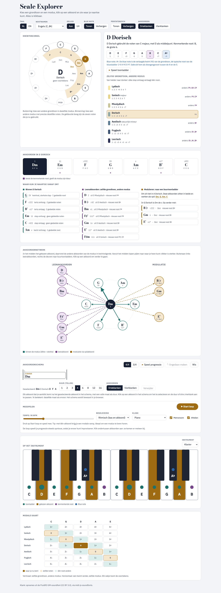

# Analyse: indeling en groepering van het werkblad

_2026-11-07. Alleen analyse, er is nog niets in de layout veranderd. Wireframes: [ux/indeling/indeling.html](ux/indeling/indeling.html). Gemeten op desktop, 1440 × 900._

## Wat er nu misloopt

| Probleem | Meting |
| --- | --- |
| **Alles staat onder elkaar** | 7 panelen. Alleen de cirkel en de modus staan naast elkaar. De pagina is **3846 px hoog, 4,3 schermen**. |
| **De klik en het resultaat liggen ver uit elkaar** | Je klikt een akkoord aan op y ≈ 1000, maar het instrument begint op **y = 2826**. Je ziet dus nooit wat een klik op het instrument doet. |
| **Dezelfde informatie staat er twee keer** | "Waar kun je naartoe" (599 px) en het akkoordnetwerk (717 px) tonen dezelfde stappen, één keer als lijst en één keer als netwerk. |
| **Wat bij elkaar hoort, staat ver uit elkaar** | De modale kaart hoort bij de modus (bovenaan), maar staat helemaal onderaan. Het schema en de loop staan los van het instrument. |
| **De kop is vol** | 6 instellingen nemen het eerste scherm in. De meeste zet je één keer en daarna nooit meer. |
| **Lege ruimte** | Onder de kwintencirkel blijft ongeveer 200 px leeg, omdat het moduspaneel langer is. |

## Hoe je de inhoud kunt groeperen
De gebruiker stelt drie vragen. Elk blok hoort bij precies één van die vragen:

| Vraag | Blokken |
| --- | --- |
| **1 · Waar ben ik?** (toonladder) | kwintencirkel · moduskop met notenrij (blue en pentatonisch) · modusladder · modi en bruggen (nu de modale kaart) |
| **2 · Welke akkoorden?** | akkoordenrij · volgende stap (lijst of netwerk) |
| **3 · Spelen** | instrument · schema · loop en tempo |
| **Instellingen** | taal · nootnamen · geluid · klank. Blue note en pentatonisch worden snelle chips bij de notenrij. |

Het **instrument** is speciaal. Het is het antwoord op vraag 1 én op vraag 2: welke noten, welk akkoord. Daarom hoort het niet onderaan, maar altijd in beeld.

## Drie varianten
| | A · Twee kolommen + dock | B · Drie werkplekken (tabs) | C · Rijen per vraag |
| --- | --- | --- | --- |
| Idee | Links blijven de cirkel en de ladder staan (navigatie), rechts staat de uitwerking. Onderaan zit een vast **dock** met het instrument en de loop. | Tabs Verkennen, Akkoorden en Spelen. Elke tab past op ongeveer één scherm. | Dezelfde pagina, maar in 3 genummerde secties, met het instrument naast de akkoorden. |
| Hoogte | ~1500 px (**1,7** schermen) | ~900 px per tab (**1**) | ~1960 px (**2,2**) |
| Resultaat van een klik zichtbaar | ●●● altijd | ●● alleen in de tab Akkoorden | ●● zolang je bij sectie 2 bent |
| Verband tussen modus en akkoord in beeld | ●●● | ● (ander tabblad) | ●● |
| Werk | M | L | S–M |
| Wireframe | [variant A](ux/indeling/shots/variant-A.png) | [variant B](ux/indeling/shots/variant-B.png) | [variant C](ux/indeling/shots/variant-C.png) |

Bij **alle drie** geldt:
- Lijst en netwerk worden **één blok met een schakelaar**, met "Modi en bruggen" als derde weergave. Dat bespaart ongeveer 700 px.
- De instellingen verdwijnen achter **⚙**. Drie- of vierklanken blijft zichtbaar.
- De uitleg onder elk paneel gaat achter een **ⓘ**.
- De modale kaart wordt "Modi en bruggen" (zie [modi-analyse.md](modi-analyse.md)).

## Advies: A, in drie stappen
A lost het grootste probleem op, namelijk dat je het resultaat van een klik niet ziet. Je hoeft er niet voor van pagina te wisselen. Elke stap is op zich al een verbetering:

1. **Opruimen (S, ongeveer een halve dag)**
   - lijst en netwerk samenvoegen tot één blok met een schakelaar;
   - instellingen achter ⚙, en blue note en pentatonisch als chips bij de notenrij;
   - uitleg achter ⓘ;
   - de modale kaart direct onder de modusladder zetten, of vervangen door Modi en bruggen.
   
   Dat brengt de pagina al van 4,3 naar ongeveer 3 schermen.
2. **Twee kolommen (M)**
   - links blijven de cirkel en de modusladder staan (`position: sticky`);
   - rechts komen de moduskop, de akkoorden, het blok "volgende stap" en het schema;
   - dezelfde verhouding 5fr/6fr als nu;
   - onder 820 px stapelt alles zoals vandaag.
3. **Instrumentdock (M)**
   - het instrument en de transportknoppen (▶/■, tempo, "nu: Dm → daarna G") staan vast onderaan;
   - het dock klapt in tot een balk van 56 px;
   - het blok "Meespelen" verhuist naar het dock;
   - de keuze uitgeklapt of ingeklapt wordt bewaard in de voorkeuren.

**B** blijft een optie voor later, als de app een telefoonversie of PWA krijgt (zie [ux-analysis.md](ux-analysis.md)). Op een groot scherm kost het je juist het overzicht.

## Open punten
- **Hoogte van het dock:** met een gitaarhals is het ongeveer 230 px, met een klavier van 2 octaven ongeveer 200 px. Is het dock op een laptop van 900 px hoog standaard ingeklapt of uitgeklapt?
- **Het schema:** blijft het in de rechterkolom, of komt het bij de loop in het dock (bijvoorbeeld als een strook met de huidige maat)?
- **Netwerk of lijst als standaard:** het netwerk is het mooiste beeld, de lijst geeft de meeste uitleg. Welke van de twee toon je eerst?
