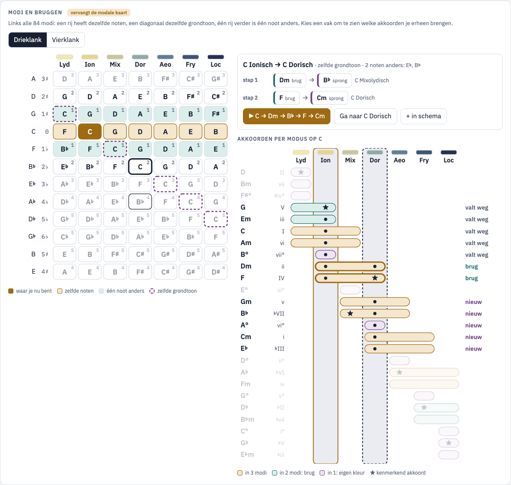
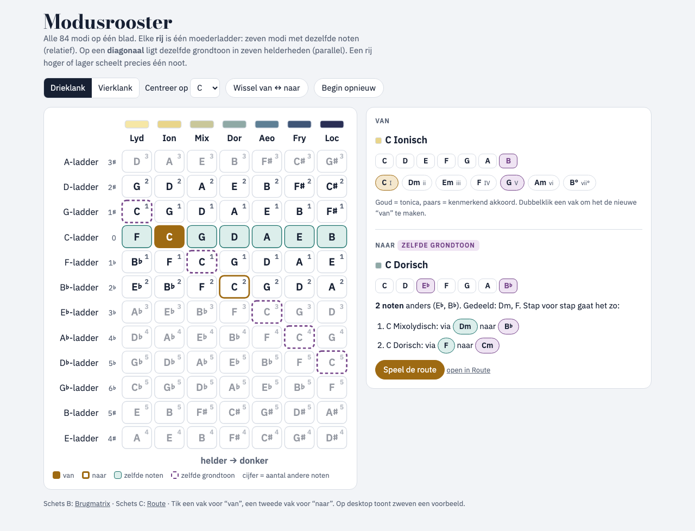
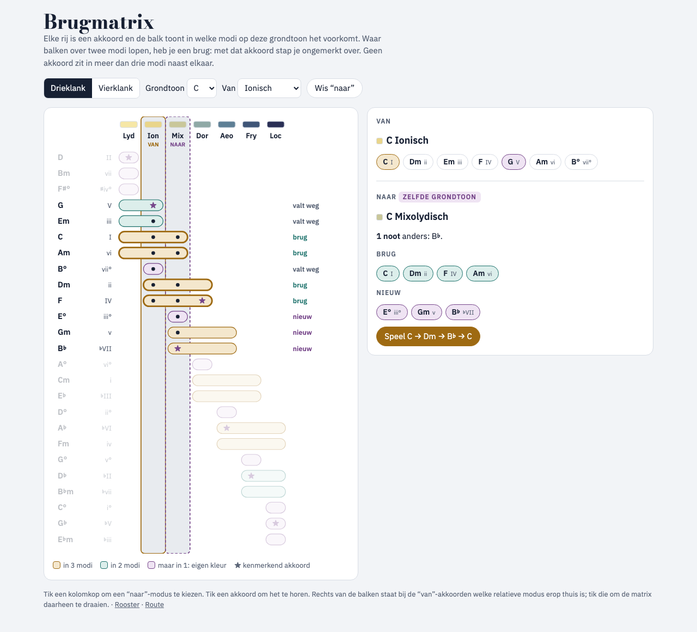
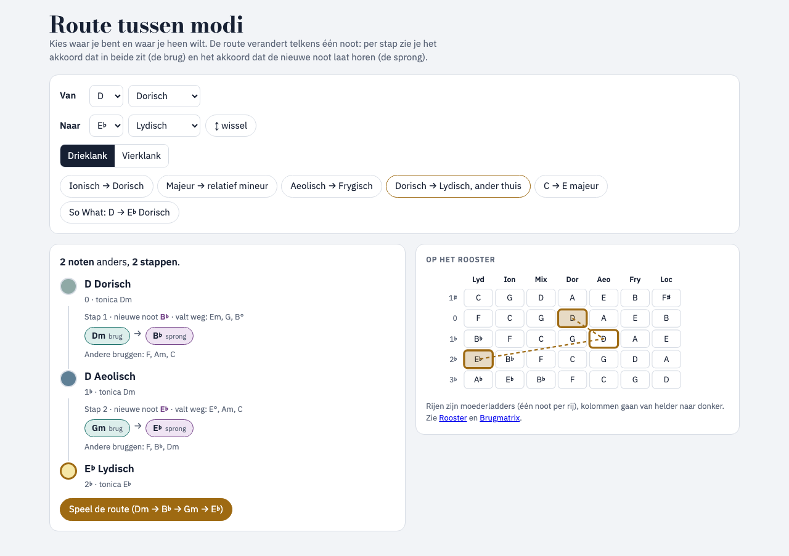

# Analyse: een weergave voor het verband tussen de modi

_2026-11-07. Alleen analyse, er is nog niets in de app gebouwd. Schetsen: [docs/ux/modi/](ux/modi/)._

## Vraag
1. Een weergave die laat zien hoe de modi met elkaar samenhangen.
2. Een overzicht van alle modi voor een ladder, waarin je ziet welke akkoorden je van de ene modus naar de andere laten springen.
3. Keuze: parallel (zelfde grondtoon) en relatief (zelfde noten) samen in één beeld.

## Wat de app nu heeft
| Weergave | Toont | Ontbreekt |
| --- | --- | --- |
| Kwintencirkel | De boog van zeven noten, de relatieve modi langs de boog | Geen parallelle modi en geen akkoorden per sprong |
| Modusladder | De zeven parallelle modi met de noot die verandert | Geen akkoorden: je ziet niet waarmee je overstapt |
| Akkoordnetwerk | Vanaf het gekozen akkoord: diatonisch, leen en spil | Alleen lokaal (één akkoord, één stap). Geen overzicht |
| Modale kaart (onderaan) | 7 modi × 5 grondtonen rond de huidige, met de voortekens | Relatieve modi liggen verspreid (niet op één lijn), geen akkoorden, en maar 35 van de 84 modi |

Het verband zit dus verspreid over vier panelen en alleen rond de huidige plek. De modale kaart komt het dichtst bij een overzicht, maar ze ordent op grondtoon in plaats van op moederladder. Daardoor zie je "zelfde noten" niet als vorm.

## Het model (nagerekend voor alle 12 grondtonen)
- **84 modi = 12 moederladders × 7 modi.** Zet je de moederladders in kwintvolgorde onder elkaar en de modi van helder naar donker naast elkaar, dan krijg je een rooster:
  - een **rij** bevat dezelfde noten: dat zijn de **relatieve** modi;
  - een **diagonaal** heeft dezelfde grondtoon: dat zijn de **parallelle** modi (elke stap donkerder is één mol meer, dus één rij lager);
  - **een rij hoger of lager scheelt precies één noot.** Verder weg loopt het verschil op tot hoogstens 5 noten (bij 5 of 6 rijen afstand).
- **Bruggen:** twee buurmodi met één noot verschil delen **4 drieklanken** of **3 vierklanken**. De andere 3 (of 4) akkoorden bevatten de nieuwe noot. Dat zijn de akkoorden die de sprong hoorbaar maken.
- **Relatieve sprong:** binnen één rij zijn alle 7 akkoorden gedeeld. De sprong is dan geen ander akkoord, maar een ander *thuis* (tonica) plus het kenmerkende akkoord van de nieuwe modus.
- **Elk akkoord zit in hoogstens 3 parallelle modi naast elkaar**, altijd aaneengesloten. Op één grondtoon komen 25 verschillende drieklanken (of 31 vierklanken) voor.
- **Kenmerkend akkoord per modus** (bevat de kenmerkende noot): Lyd **II**, Ion **V**, Mix **♭VII**, Dor **IV**, Aeo **♭VI**, Fry **♭II**, Loc **♭V**.

Dit volgt uit het boogmodel in de README: één stap op de kwintencirkel betekent één noot anders.

## Voorstel in de huidige layout: [d-in-app.html](ux/modi/d-in-app.html)

Dit is één breed paneel, **"Modi en bruggen"**. Het **vervangt de modale kaart** onderaan het werkblad (`section.panel.wide.mapsec`) en gebruikt de bestaande CSS, kleuren en legenda's. De schets laadt `src/styles/index.css` zelf.
- **Links (5fr) staat het rooster (A)**: alle 84 modi. Het vak "waar je nu bent" is de app-toestand. Dezelfde noten zijn goud gekleurd, één noot verschil is groen, dezelfde grondtoon heeft een stippelrand, en een cijfer geeft het aantal noten verschil. De legenda is die van de huidige modale kaart, met één extra item.
- **Rechts (6fr) staat eerst de sprongkaart**: van → naar, met brug, sprong en wat wegvalt (of de route per stap). Daaronder staan **Speel** en **Ga naar**, en later **+ in schema**.
- **Rechts daaronder staat de brugmatrix (B)** voor de grondtoon: welke akkoorden in welke modi zitten. Je kunt op een kolom tikken als alternatief voor het rooster.
- De verhouding 5fr/6fr is dezelfde als die van de kwintencirkel en het moduspaneel erboven, dus de kolommen lijnen uit. Onder 820 px stapelt alles zoals de rest van het werkblad.

Varianten A, B en C hieronder zijn de losse verkenningen waaruit dit paneel is samengesteld.

## Drie varianten (los verkend)

### A · Modusrooster: [a-rooster.html](ux/modi/a-rooster.html)

- Alle 84 modi in één raster: 12 rijen (moederladders, ♯ boven, ♭ onder) en 7 kolommen (Lyd tot Loc). Rijen zijn relatief, diagonalen zijn parallel. Een cijfer in elk vak geeft het aantal noten verschil met "van".
- Tik op "van" en daarna op "naar". Het paneel toont de nieuwe noot of noten, de **brug** (de gedeelde akkoorden), de **sprong** (de akkoorden met de nieuwe noot) en wat er wegvalt. Is "naar" verder dan één noot, dan toont het de kortste route stap voor stap. Elke chip speelt het akkoord.
- **Sterk:** dit is het enige beeld dat parallel en relatief echt samen laat zien. "Waarom is Dorisch dicht bij Ionisch" wordt hier geometrie.
- **Zwak:** de akkoorden zelf zie je alleen in het paneel en niet in het rooster.

### B · Brugmatrix: [b-brugmatrix.html](ux/modi/b-brugmatrix.html)

- Eén grondtoon. De kolommen zijn de 7 parallelle modi, de rijen alle 25 akkoorden die erin voorkomen. Een balk toont in welke modi een akkoord zit. Een balk over 2 of 3 kolommen is een **brug**, een balk over 1 kolom is de **eigen kleur** van die modus, en ★ markeert het kenmerkende akkoord.
- Kies "van" en tik op een kolomkop voor "naar". Dan krijgt elk akkoord een label: brug, nieuw of valt weg.
- Om relatief en parallel in één beeld te tonen, staat naast elk "van"-akkoord in welke relatieve modus het thuis is ("thuis in D Dor ›"). Een tik draait de matrix naar die grondtoon.
- **Sterk:** dit beantwoordt de vraag "welke akkoorden laten me springen" het meest direct. Het is compact (7 kolommen) en volgt dezelfde volgorde als de modusladder.
- **Zwak:** één grondtoon tegelijk. Het relatieve verband zie je alleen als tekst, niet als vorm.

### C · Route: [c-route.html](ux/modi/c-route.html)

- Kies "van" en "naar", dan berekent de app de kortste route. Per stap verandert één noot, en de stap toont de **brug** en de **sprong**. Is de moederladder al goed, dan volgt een stap "zelfde noten, nieuw thuis". Een minirooster tekent de route.
- Er zijn presets: Ionisch → Dorisch, majeur → relatief mineur, So What (D → E♭ Dorisch: 5 stappen, dus "spring bewust zonder brug"). **Speel de route** speelt de hele keten.
- **Sterk:** dit is didactisch en direct bruikbaar om te componeren. Het kan ook een progressie in het schema voorstellen.
- **Zwak:** het geeft geen overzicht. Je moet al weten waar je heen wilt.

## Vergelijking
| | A Rooster | B Brugmatrix | C Route |
| --- | --- | --- | --- |
| Verband tussen modi (vraag 1) | ●●● | ●● | ● |
| Welke akkoorden voor de sprong (vraag 2) | ●● (in het paneel) | ●●● | ●●● (per stap) |
| Parallel en relatief in één beeld | ●●● | ●● | ●● |
| Past in het huidige werkblad | ●●● (vervangt de modale kaart) | ●●● | ● (eigen scherm) |
| Werk in de app | M | S–M | M |

## Advies
Bouw **het paneel uit schets D**: A en B samen, op de plek van de modale kaart.
- **A is de kaart**: het overzicht, en de plek waar je kiest.
- **B is de zoom**: de akkoorden per modus voor die grondtoon.
- **De route uit C** komt in de sprongkaart wanneer "naar" verder dan één noot ligt.

Een aparte route-planner (C als eigen scherm) wordt pas zinvol als hij een progressie kan toevoegen aan het schema. Dat is een tweede stap.

Volgorde: eerst **het rooster**, want het vervangt de modale kaart één op één. Daarna **de sprongkaart en de matrix**.

## Inbouw in de app (schets)
- **`core/navigation.ts`**, puur en te testen:
  - `parentIndex(root, mode)` en `rootAt(parent, mode)`;
  - `bridge(a, b, size)` → `{ newNotes, shared, fresh, gone, kind: 'relative'|'parallel'|'neighbour' }`;
  - `route(a, b, size)` → stappen met `pivot` en `signal`;
  - `CHAR_CHORD_DEGREE` naast het bestaande `CHAR_DEGREE` in `theory.ts`.
  
  Tests: 4/3 gedeelde akkoorden, een spanwijdte van hoogstens 3, de lengte van de route gelijk aan de kwintafstand, en het kenmerkende akkoord dat de kenmerkende noot bevat.
- **`views/ModeMap.tsx`** (A) vervangt `ModalMap` in `Panels.tsx`. Daarnaast komen **`views/BridgeMatrix.tsx`** (B) en een sprongkaart, met SVG zoals `ChordNetwork`. In `App.tsx` wordt de sectie `mapsec` het nieuwe paneel. "Waar je nu bent" is `state.root`/`state.mode`, en "naar" is lokale component-state. **Ga naar** stuurt `setScale` (zoals de modale kaart nu doet), en een akkoordchip speelt het akkoord via de bestaande `chordEvents`.
- **i18n**: ongeveer 15 sleutels in `nl.ts` en `en.ts` (bridge, fresh, gone, newHome, route…).
- **Later**: "Voeg route toe aan schema" maakt van `route()` een reeks `PathEntry`'s (pivot en signal, 2 tellen elk).

**Werk:** de core met tests is S, B is S–M, A is M. Samen ongeveer 1,5 tot 2 dagen.

## Open punten
- **Grootte:** de schetsen hebben een eigen schakelaar tussen drie- en vierklanken. In de app ligt het voor de hand om `state.size` te volgen.
- **Klikgedrag:** nu verplaatst één klik op de modale kaart je meteen. In de schets kiest een klik eerst "naar", zodat je de brug ziet, en verplaats je pas met **Ga naar**. Welke van de twee wil je?
- **Hoogte:** de matrix telt 25 rijen (31 bij vierklanken) en maakt het paneel hoger dan de modale kaart. Een alternatief is om alleen de rijen van "van" en "naar" te tonen, met een knop "alle akkoorden".
- **Uitbreiding:** met harmonisch en melodisch mineur (punt 5 in [analysis.md](analysis.md)) krijgt het rooster extra lagen. Het model blijft gelijk (afstand = aantal verschillende noten), maar een vlak raster volstaat dan niet meer. Ontwerp de core-functies daarom met een `family`-parameter.
