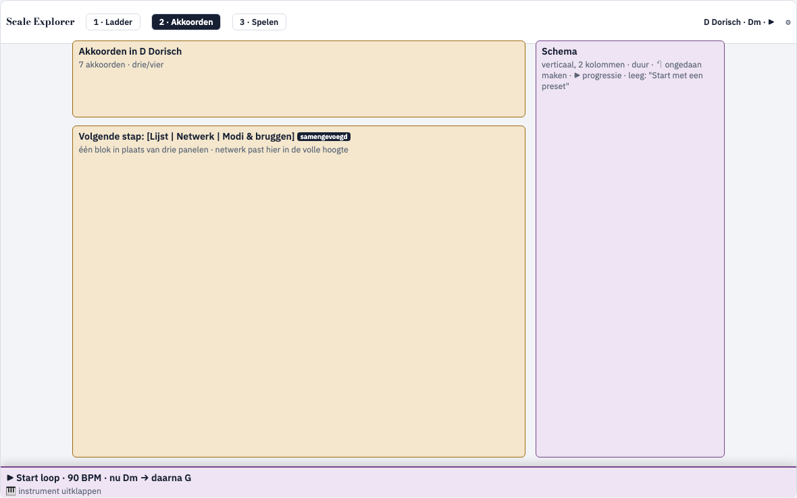

# Analyse: opdelen in logische schermen

_2026-11-07. Alleen analyse. Prototype: [ux/schermen/schermen.html](ux/schermen/schermen.html). Dit bouwt verder op [indeling-analyse.md](indeling-analyse.md) en werkt variant B ("drie werkplekken") daaruit verder uit._

## Conclusie
**Ja, logische schermen zijn beter**, maar alleen met twee dingen die op elk scherm blijven staan:
1. een **contextbalk** bovenaan, met de huidige toonladder en het huidige akkoord (*D Dorisch · Dm · ▶*);
2. een **instrumentdock** onderaan, met het instrument en de loop.

Zonder die twee verlies je het sterkste punt van de app: elke klik zie en hoor je meteen. Met die twee past elk scherm op één laptopscherm, zonder te scrollen. Vandaag is de pagina 4,3 schermen lang.

## Waarom het nu tijd is
- **De app is gegroeid**: 7 panelen, plus pentatonisch, de blue note, de saxtranspositie en straks "Modi en bruggen" en presets. Op één pagina wordt elke uitbreiding nog een blok onderaan.
- **De taken zijn verschillend**: een modus leren, een progressie bouwen en meespelen. Dat doe je zelden tegelijk, maar binnen één taak heb je alles samen nodig. Precies dat lukt op één lange pagina niet (zie de tabel).
- **Het is de basis voor later**: dezelfde drie schermen worden op een telefoon of als PWA een tabbalk onderaan (zie [ux-analysis.md](ux-analysis.md)). Op één lange pagina lukt dat niet.

## Waar de grenzen liggen
De regel: **wat een klik verandert, moet op hetzelfde scherm zichtbaar zijn.**

| Klik | Verandert | Dus samen op één scherm |
| --- | --- | --- |
| Een grondtoon of modus (cirkel, ladder) | noten, akkoorden, instrument | ladder + noten + instrument |
| Een akkoord (rij, lijst, netwerk) | het schema (`withPush` voegt toe), het instrument, de klank | akkoorden + **schema** |
| Moduleren of lenen (`go`) | de toonladder | akkoorden + contextbalk (nieuwe toonladder) |
| Start loop | het huidige akkoord loopt mee | schema + instrument + noten |

Hieruit volgt één belangrijke keuze: **het schema hoort bij Akkoorden, niet bij Spelen**. Op Spelen komt het terug als een strook die meeloopt met de loop.

## De drie schermen
| Scherm | Vraag | Inhoud | Dock |
| --- | --- | --- | --- |
| [**1 · Ladder**](ux/schermen/shots/ladder.png) | Waar ben ik? | kwintencirkel · moduskop met notenrij (chips blue/penta, ▶) · modusladder | open: je ziet de noten op je instrument |
| [**2 · Akkoorden**](ux/schermen/shots/akkoorden.png) | Welke akkoorden, en waarheen? | akkoordenrij · **volgende stap: Lijst / Netwerk / Modi & bruggen** · schema rechts | ingeklapt tot een balk van 56 px (▶, tempo, nu → daarna) |
| [**3 · Spelen**](ux/schermen/shots/spelen.png) | Meespelen | transport · schema als meelopende strook · groot "Nu: Dm → daarna G" met de noten om te spelen · groot instrument | niet nodig: het scherm ís het dock |
| ⚙ (paneel) | instellingen | taal · nootnamen · geluid · klank · thema | n.v.t. |

**Modi en bruggen** staat op Akkoorden en niet op Ladder. Het gaat er om met welke akkoorden je springt, en daar zit het naast het netwerk en het schema.

## Vergelijking met één pagina plus dock (variant A)
| | Eén pagina + dock (A) | Schermen + contextbalk + dock |
| --- | --- | --- |
| Scrollen op 1440 × 900 | ~1,7 schermen | geen |
| Alles tegelijk zien om te verkennen | ●●● | ●● (één tik of sneltoets) |
| Focus per taak | ● | ●●● |
| Ruimte voor groei (presets, oortraining, licks) | ● (nog langer) | ●●● (een vierde scherm, bv. *Oefenen*) |
| Telefoon en PWA later | herbouwen | dezelfde structuur, als tabbalk |
| Werk | M | M–L |

## Wat er technisch moet gebeuren
1. **Navigatie zonder router**: `screen` in de store, gekoppeld aan `location.hash` (`#ladder`, `#akkoorden`, `#spelen`). Terug en vooruit werken dan in de browser, en je kunt een link naar een scherm delen. De laatste keuze wordt bewaard in `tln-prefs`. Sneltoetsen 1, 2 en 3.
2. **De loop naar de store verhuizen**: nu leeft `LoopPlayer` in `views/Loop.tsx` (`useRef`). Verlaat je dat scherm, dan unmount de component en stopt de loop of blijft hij onbestuurbaar spelen. Dat is een **verplichte voorwaarde**: één speler in de store of in een module, en `LoopControls` wordt dan een weergave ervan (in het dock en op Spelen).
3. **Layout**: `App.tsx` krijgt `<ContextBar/>`, een `<Screen/>` per tab en `<Dock/>`. De bestaande panelen blijven zoals ze zijn en worden alleen anders geplaatst. Het schema krijgt een verticale variant (op Akkoorden) en een strook (op Spelen).
4. **Lijst / Netwerk / Modi & bruggen** worden één blok met een schakelaar. De keuze wordt bewaard.
5. **Tests**: de reducer voor `screen`, de hash-synchronisatie, en dat de loop blijft lopen als je van scherm wisselt.

**Werk:** ongeveer 2 dagen. De loop naar de store verhuizen is ongeveer een halve dag daarvan. Wil je "Modi en bruggen" erbij, reken dan nog 1,5 dag extra (zie [modi-analyse.md](modi-analyse.md)).

## Risico's en hoe je ze opvangt
- **"Waar is X?"** Een wisselend scherm verbergt dingen. Daarom staan de tabs altijd zichtbaar bovenaan, met nummers en sneltoetsen. Verwijzingen springen mee: "moduleren naar G Dorisch" laat het scherm staan, maar een klik op de contextbalk opent Ladder.
- **Het verband tussen theorie en akkoorden** ("waarom past dit akkoord") was op één pagina zichtbaar door te scrollen. Dat vang je op met de contextbalk, met de nieuwe noot die al bij elke stap staat, en met Modi en bruggen op het scherm Akkoorden.
- **Bestaande gebruikers** missen de lange pagina misschien. Begin daarom op het scherm dat ze het laatst gebruikten, en laat bij het eerste bezoek een korte rondleiding zien: Ladder, dan Akkoorden, dan Spelen.

## Voorgestelde volgorde
1. De loop naar de store verhuizen (onzichtbaar, maar noodzakelijk).
2. De contextbalk, de tabs met hash en het ⚙-paneel.
3. Lijst, Netwerk en Modi & bruggen samenvoegen, en het schema op Akkoorden.
4. Het dock en het scherm Spelen.

## Open punten
- **Drie of vier schermen?** Een vierde scherm, *Oefenen* (oortraining, licks, presets), past in deze structuur zodra die inhoud er is.
- **Het dock op Akkoorden:** standaard ingeklapt (rustiger) of open (je ziet het akkoord op je instrument)?
- **Startscherm:** altijd Ladder, of het scherm dat je het laatst gebruikte?
